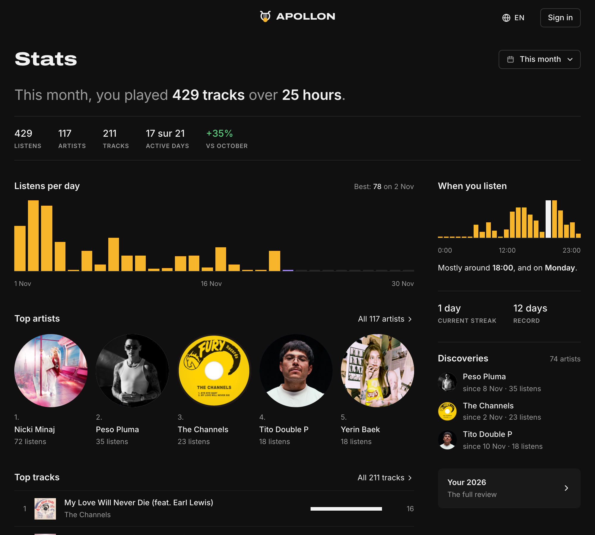
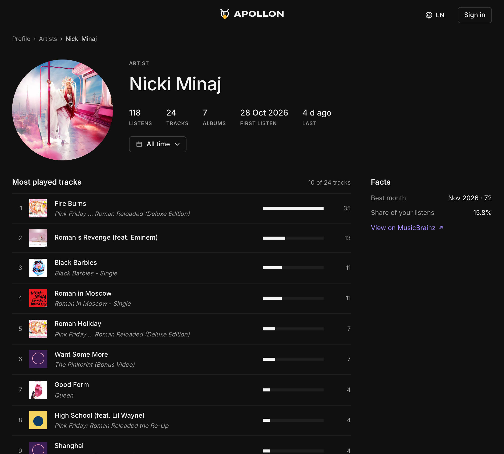
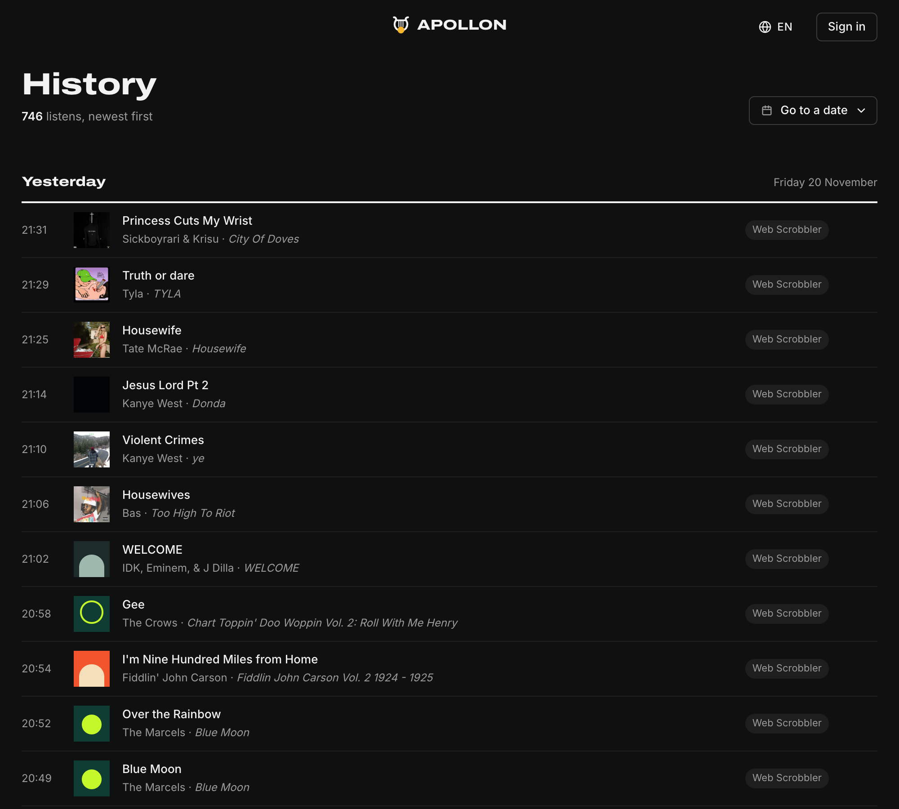
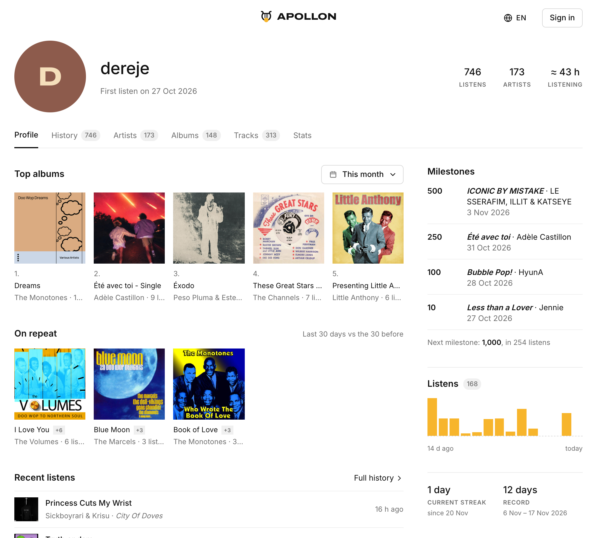

<a id="readme-top"></a>

<br />
<div align="center">
  <a href="https://github.com/powpowchuuuu/stunning-winner">
    
  </a>

  <h1 align="center">Apollon</h1>

  <p align="center">
    <strong>A self-hosted, open source music scrobbler for Cloudflare Workers.</strong>
    <br />
    ListenBrainz-compatible, with listening stats and a yearly "Wrapped"-style review.
    <br />
    <br />
    <a href="https://apollon.dereje.cc/u/dereje"><strong>See a live instance »</strong></a>
    <br />
    <br />
    <a href="#getting-started">Deploy your own</a>
    &middot;
    <a href="https://github.com/powpowchuuuu/stunning-winner/issues/new?labels=bug">Report Bug</a>
    &middot;
    <a href="https://github.com/powpowchuuuu/stunning-winner/issues/new?labels=enhancement">Request Feature</a>
  </p>
</div>

<details>
  <summary>Table of Contents</summary>
  <ol>
    <li>
      <a href="#about-the-project">About The Project</a>
      <ul>
        <li><a href="#features">Features</a></li>
        <li><a href="#screenshots">Screenshots</a></li>
        <li><a href="#built-with">Built With</a></li>
      </ul>
    </li>
    <li>
      <a href="#getting-started">Getting Started</a>
      <ul>
        <li><a href="#prerequisites">Prerequisites</a></li>
        <li><a href="#installation">Installation</a></li>
        <li><a href="#deploy-to-cloudflare-with-turso">Deploy to Cloudflare with Turso</a></li>
        <li><a href="#local-development">Local development</a></li>
      </ul>
    </li>
    <li>
      <a href="#usage">Usage</a>
      <ul>
        <li><a href="#connect-a-scrobbling-app">Connect a scrobbling app</a></li>
        <li><a href="#import-your-lastfm-history">Import your Last.fm history</a></li>
        <li><a href="#api">API</a></li>
      </ul>
    </li>
    <li><a href="#architecture">Architecture</a></li>
    <li><a href="#roadmap">Roadmap</a></li>
    <li><a href="#contributing">Contributing</a></li>
    <li><a href="#license">License</a></li>
    <li><a href="#contact">Contact</a></li>
    <li><a href="#acknowledgments">Acknowledgments</a></li>
  </ol>
</details>

## About The Project

[![Apollon profile page in the dark theme: top albums, on repeat, milestones, listening streak and recent listens][product-screenshot]](https://apollon.dereje.cc/u/dereje)

**Apollon is a self-hosted, ListenBrainz-compatible music scrobbler you deploy on your own Cloudflare account.**
Track every song you play, browse your listening history, and get detailed listening stats and a yearly
"Wrapped"-style review, without handing your data to a third party. It is a free, open source alternative to
Last.fm and a self-hostable ListenBrainz server, built on Cloudflare Workers, Turso and Workers KV with Hono and
Better Auth.

Why another scrobbler?

- **Your data, your account.** Listens live in your own Turso (libSQL) database. Export, query or delete them whenever you like.
- **Works with the apps you already use.** The server speaks the ListenBrainz API, so any scrobbler that can point at a custom ListenBrainz server can send listens to it.
- **Cheap to run.** Two Workers, one Turso database and one KV namespace. A personal instance fits comfortably in the free tiers of Cloudflare and Turso.
- **Open source.** AGPL-3.0, no tracking, no ads.

### Features

- **ListenBrainz-compatible API** at `/1`: submit listens, now playing, token validation, listen history, listen count, delete a listen, latest import and top artists / recordings / releases.
- **Native JSON API** at `/v1` with an OpenAPI 3 document (`/v1/openapi.json`) and interactive docs (`/v1/docs`).
- **Listening statistics** for any period (this week, this month, this year, last quarter, all time…): top artists, albums and tracks, daily activity, listening clock, streaks, discoveries, forgotten favourites, on repeat, trends, period comparison, one-shots, weekly charts, diversity, listening sessions, repeats, milestones and "on this day".
- **Year in review**, a Spotify Wrapped-style recap of your year: artist of the year, top albums, totals and highlights.
- **Artist, album and track pages** with first and last listen, play counts and a timeline.
- **Album art and artist pictures** from the Cover Art Archive (by MusicBrainz release ID) with a Deezer fallback by name, cached at the edge.
- **Last.fm import** from a CSV export.
- **Accounts and API tokens** with Better Auth (username + password, per-app API keys that you can revoke).
- **Single-user by default**: sign-up closes once the first account exists, and the owner can reopen it from the settings.
- **Private profiles**: hide your listens and stats from everyone but yourself.
- **English and French**, light and dark themes.
- **Rate limiting** on the API and auth endpoints.

### Screenshots

Browse a real profile on the [live instance](https://apollon.dereje.cc/u/dereje).

| Listening stats                                                                                                          | Year in review                                                                                                     |
| ------------------------------------------------------------------------------------------------------------------------ | ------------------------------------------------------------------------------------------------------------------ |
|  |  |

| Artist page                                                                                | Top artists                                                                        |
| ------------------------------------------------------------------------------------------ | ---------------------------------------------------------------------------------- |
|  |  |

| Listening history                                                                   | Light theme                                                            |
| ----------------------------------------------------------------------------------- | ---------------------------------------------------------------------- |
|  |  |

### Built With

- [![Cloudflare Workers][Workers]][Workers-url]
- [![Turso][Turso]][Turso-url]
- [![Hono][Hono]][Hono-url]
- [![Better Auth][BetterAuth]][BetterAuth-url]
- [![TanStack Start][TanStack]][TanStack-url]
- [![React][React]][React-url]
- [![Panda CSS][Panda]][Panda-url]
- [![Zag.js][Zag]][Zag-url]
- [![Vite+][Vite]][Vite-url]
- [![TypeScript][TypeScript]][TypeScript-url]

<p align="right">(<a href="#readme-top">back to top</a>)</p>

## Getting Started

Apollon runs as two Cloudflare Workers (the API and the web front) on top of a Turso database and a Workers KV
namespace. The steps below deploy a personal instance from your machine.

### Prerequisites

- A [Cloudflare](https://dash.cloudflare.com/sign-up) account
- A [Turso](https://turso.tech/) account and the `turso` CLI
- Node.js 22.18 or newer
- [Vite+](https://viteplus.dev/) (`vp`), which installs the pinned pnpm for you

### Installation

```bash
git clone https://github.com/powpowchuuuu/stunning-winner.git apollon
cd apollon
vp install
```

### Deploy to Cloudflare with Turso

1. **Create the database and the cache.**

   ```bash
   cd apps/api
   turso db create scrobbler
   npx wrangler kv namespace create CACHE
   ```

2. **Store their credentials locally.** Copy `apps/api/.env.turso.example` to `apps/api/.env.turso` and fill in
   `TURSO_DATABASE_URL` (`turso db show scrobbler --url`) and `TURSO_AUTH_TOKEN` (`turso db tokens create scrobbler`).
   Copy `apps/api/.env.cloudflare.example` to `apps/api/.env.cloudflare` and fill in `KV_CACHE_ID`. Both files are
   git-ignored: `wrangler.jsonc` keeps a placeholder ID that the deploy script replaces at deploy time, so your
   account's IDs and tokens never end up in the repository.

3. **Set the secrets, run the migrations and deploy the API.**

   ```bash
   openssl rand -base64 32 | npx wrangler secret put BETTER_AUTH_SECRET
   turso db show scrobbler --url | npx wrangler secret put TURSO_DATABASE_URL
   turso db tokens create scrobbler | npx wrangler secret put TURSO_AUTH_TOKEN
   vp run db:migrate
   vp run deploy
   ```

4. **Deploy the web front.** It reaches the API Worker through a service binding, so both share one origin and
   Better Auth cookies stay first-party. To serve it on your own domain, copy `apps/web/.env.cloudflare.example`
   to `apps/web/.env.cloudflare` and set `WEB_DOMAINS` (for example `scrobbler.example.com`, on a zone of your
   Cloudflare account): the deploy attaches it as a custom domain. Without it the front stays on workers.dev.

   ```bash
   cd ../web
   vp run deploy
   ```

5. **Trust the web origin and create your account.** Set `TRUSTED_ORIGINS` in `apps/api/wrangler.jsonc` to the
   URL of your web front (for example `https://scrobbler.example.com`), then redeploy the API. Open the web app and
   create your account: sign-up closes behind you, and you can reopen it from the settings.

Optional API variable: `BASE_URL`, the public URL used by Better Auth (defaults to the request origin).

### Local development

```bash
cp apps/api/.dev.vars.example apps/api/.dev.vars   # set BETTER_AUTH_SECRET
cp apps/web/.dev.vars.example apps/web/.dev.vars
turso dev --db-file .turso/dev.db                  # local libSQL server on http://127.0.0.1:8080 (keep it running)
TURSO_DATABASE_URL=http://127.0.0.1:8080 vp run @scrobbler/api#db:migrate
cd apps/api && vp run dev                          # API on http://localhost:8787
cd apps/web && vp run dev                          # web front on http://localhost:3000
```

Signing in from the local web front also needs `TRUSTED_ORIGINS=http://localhost:3000` in `apps/api/.dev.vars`.

```bash
vp check --fix    # format, lint, type-check
vp run -r test    # all tests
```

<p align="right">(<a href="#readme-top">back to top</a>)</p>

## Usage

### Connect a scrobbling app

Because the server implements the ListenBrainz API, you connect apps the same way you would connect them to
ListenBrainz: pick **ListenBrainz** (or "custom ListenBrainz server") in the app, then paste your server URL and
an API token. Create the token in the web app under **Settings → API tokens**; the page shows the server URL to
use next to it.

Apps that let you set a custom ListenBrainz URL include:

| App                                                             | Platform                                                                |
| --------------------------------------------------------------- | ----------------------------------------------------------------------- |
| [Pano Scrobbler](https://github.com/kawaiiDango/pano-scrobbler) | Android, Windows, Linux                                                 |
| [Web Scrobbler](https://web-scrobbler.com/)                     | Browser extension (YouTube, Spotify Web, Bandcamp, SoundCloud…)         |
| [Navidrome](https://www.navidrome.org/)                         | Self-hosted music server                                                |
| [Jellyfin](https://jellyfin.org/) (ListenBrainz plugin)         | Self-hosted media server                                                |
| [Multi-Scrobbler](https://github.com/FoxxMD/multi-scrobbler)    | Self-hosted bridge for Spotify, Plex, Jellyfin, Subsonic, MPD, Last.fm… |

Anything else that talks to the ListenBrainz API with a configurable root URL should work too. Some apps want
the root URL (`https://scrobbler.example.com`), others want the API path (`https://scrobbler.example.com/1/`).

### Import your Last.fm history

Export your scrobbles from Last.fm as CSV, then drop the file under **Settings → Import**. It is read in your
browser and sent in batches of 1,000 listens; re-importing the same file is harmless because duplicates are
ignored.

### API

| Path               | What it is                                                               |
| ------------------ | ------------------------------------------------------------------------ |
| `/1/*`             | ListenBrainz API v1. Authenticate with `Authorization: Token <api key>`. |
| `/v1/*`            | Native JSON API: listens, now playing, profile, stats and insights.      |
| `/v1/openapi.json` | OpenAPI document for `/v1`.                                              |
| `/v1/docs`         | Interactive API reference.                                               |
| `/api/auth/*`      | Better Auth (sign-up, sign-in, sessions, API keys).                      |

Submit a listen exactly as you would to ListenBrainz:

```bash
curl -X POST https://scrobbler.example.com/1/submit-listens \
  -H "Authorization: Token $TOKEN" \
  -H "Content-Type: application/json" \
  -d '{
    "listen_type": "single",
    "payload": [{
      "listened_at": 1763650000,
      "track_metadata": { "artist_name": "Nicki Minaj", "track_name": "Super Bass" }
    }]
  }'
```

Read stats from the native API:

```bash
curl https://scrobbler.example.com/v1/users/<username>/stats/summary
curl "https://scrobbler.example.com/v1/users/<username>/stats/artists?range=this_month"
curl https://scrobbler.example.com/v1/users/<username>/stats/wrapped
```

Errors always look like `{ "code": 404, "error": "…" }` and timestamps are Unix seconds (UTC). See `/v1/docs` on
your instance for every endpoint, parameter and response field.

<p align="right">(<a href="#readme-top">back to top</a>)</p>

## Architecture

```
apps/
  api/        Hono Worker: /1 (ListenBrainz), /v1 (native API + OpenAPI), /api/auth (Better Auth)
  web/        TanStack Start front (Panda CSS, Zag.js) on its own Worker, relays API paths via a service binding
packages/
  types/      Wire and domain types
  core/       Business rules behind ports: no I/O, no Cloudflare
  db-d1/      SQLite repositories (D1-shaped driver) and SQL migrations
  db-libsql/  Turso / libSQL driver for those repositories (production database)
  cache-kv/   Workers KV cache
  auth/       Better Auth setup (username + API key plugins)
  testing/    Node-only test doubles (D1 on node:sqlite, KV in memory)
```

- **Ports and adapters.** The core knows nothing about Cloudflare. Storage, cache and auth are adapters, so another database (Postgres, SQLite…) is a new `packages/db-<name>` that passes the same tests.
- **Protocols are thin.** ListenBrainz and the native API only map their wire format onto the same core services, so a Last.fm-compatible endpoint would be one more folder.
- **Built for Turso's billing.** Turso charges per row scanned and written: batch inserts use a single `json_each` statement, every listen read is bounded by an index (a test checks every query plan), counters are maintained instead of counted, and stats of large histories are cached in KV keyed by the listen count, so new listens invalidate them naturally. The same SQL also runs on Cloudflare D1.

More detail for contributors is in [AGENTS.md](AGENTS.md).

<p align="right">(<a href="#readme-top">back to top</a>)</p>

## Roadmap

- [x] ListenBrainz-compatible API (`/1`)
- [x] Native JSON API with OpenAPI docs (`/v1`)
- [x] Listening stats and insights
- [x] Year in review
- [x] Last.fm CSV import
- [x] Private profiles and single-user sign-up
- [x] English and French, light and dark themes
- [x] Turso as the production database
- [ ] MCP server, so AI assistants can read your listening history and stats
- [ ] Last.fm-compatible scrobbling API
- [ ] More languages

See the [open issues](https://github.com/powpowchuuuu/stunning-winner/issues) for proposed features and known issues.

<p align="right">(<a href="#readme-top">back to top</a>)</p>

## Contributing

Contributions are welcome. If you have an idea that would make Apollon better, open an issue with the
`enhancement` label or send a pull request.

1. Fork the project
2. Create your feature branch (`git checkout -b feature/my-feature`)
3. Run `vp check --fix` and `vp run -r test`
4. Commit your changes (`git commit -m "Add my feature"`)
5. Push to the branch (`git push origin feature/my-feature`)
6. Open a pull request

Read [AGENTS.md](AGENTS.md) first: it lists the dependency rules the codebase keeps.

<p align="right">(<a href="#readme-top">back to top</a>)</p>

## License

Distributed under the GNU Affero General Public License v3.0. See [LICENSE](LICENSE) for details. If you run a
modified version as a public service, you must share your changes.

<p align="right">(<a href="#readme-top">back to top</a>)</p>

## Contact

Open an [issue](https://github.com/powpowchuuuu/stunning-winner/issues) for questions, bugs and ideas.

Project link: [github.com/powpowchuuuu/stunning-winner](https://github.com/powpowchuuuu/stunning-winner)

Live instance: [apollon.dereje.cc](https://apollon.dereje.cc/u/dereje)

<p align="right">(<a href="#readme-top">back to top</a>)</p>

## Acknowledgments

- [ListenBrainz](https://listenbrainz.org/) and the [MetaBrainz Foundation](https://metabrainz.org/), for the open API this server implements
- [MusicBrainz](https://musicbrainz.org/) and the [Cover Art Archive](https://coverartarchive.org/), for open music metadata and album art
- [Deezer](https://developers.deezer.com/), for artist pictures and fallback covers
- [Last.fm](https://www.last.fm/), for the scrobbling idea and the export format
- [Best-README-Template](https://github.com/othneildrew/Best-README-Template), for the layout of this README
- [Shields.io](https://shields.io/), for the badges

<p align="right">(<a href="#readme-top">back to top</a>)</p>

<!-- MARKDOWN LINKS & IMAGES -->

[product-screenshot]: docs/screenshots/profile.png
[Workers]: https://img.shields.io/badge/Cloudflare_Workers-F38020?style=for-the-badge&logo=cloudflareworkers&logoColor=white
[Workers-url]: https://workers.cloudflare.com/
[Turso]: https://img.shields.io/badge/Turso-4FF8D2?style=for-the-badge&logo=turso&logoColor=black
[Turso-url]: https://turso.tech/
[Hono]: https://img.shields.io/badge/Hono-E36002?style=for-the-badge&logo=hono&logoColor=white
[Hono-url]: https://hono.dev/
[BetterAuth]: https://img.shields.io/badge/Better_Auth-000000?style=for-the-badge&logo=betterauth&logoColor=white
[BetterAuth-url]: https://www.better-auth.com/
[TanStack]: https://img.shields.io/badge/TanStack_Start-FF4154?style=for-the-badge&logo=reactquery&logoColor=white
[TanStack-url]: https://tanstack.com/start
[React]: https://img.shields.io/badge/React-20232A?style=for-the-badge&logo=react&logoColor=61DAFB
[React-url]: https://react.dev/
[Panda]: https://img.shields.io/badge/Panda_CSS-F6E458?style=for-the-badge&logo=pandacss&logoColor=black
[Panda-url]: https://panda-css.com/
[Zag]: https://img.shields.io/badge/Zag.js-2CC5D2?style=for-the-badge
[Zag-url]: https://zagjs.com/
[Vite]: https://img.shields.io/badge/Vite%2B-646CFF?style=for-the-badge&logo=vite&logoColor=white
[Vite-url]: https://viteplus.dev/
[TypeScript]: https://img.shields.io/badge/TypeScript-3178C6?style=for-the-badge&logo=typescript&logoColor=white
[TypeScript-url]: https://www.typescriptlang.org/
