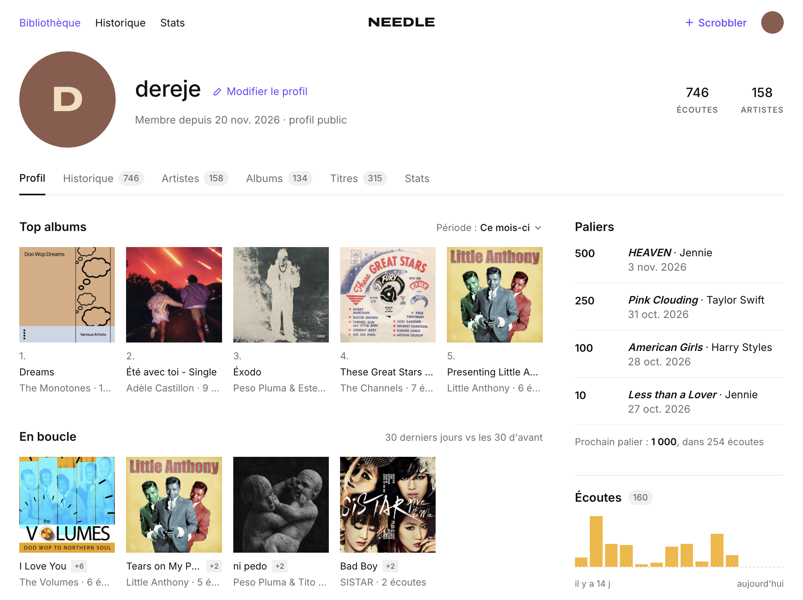
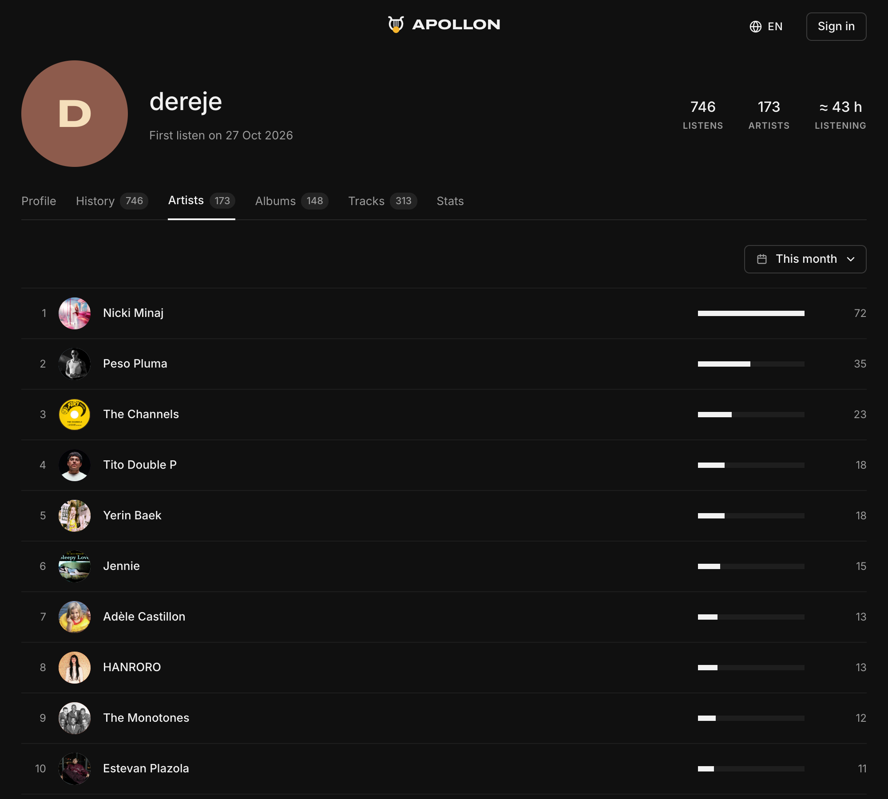
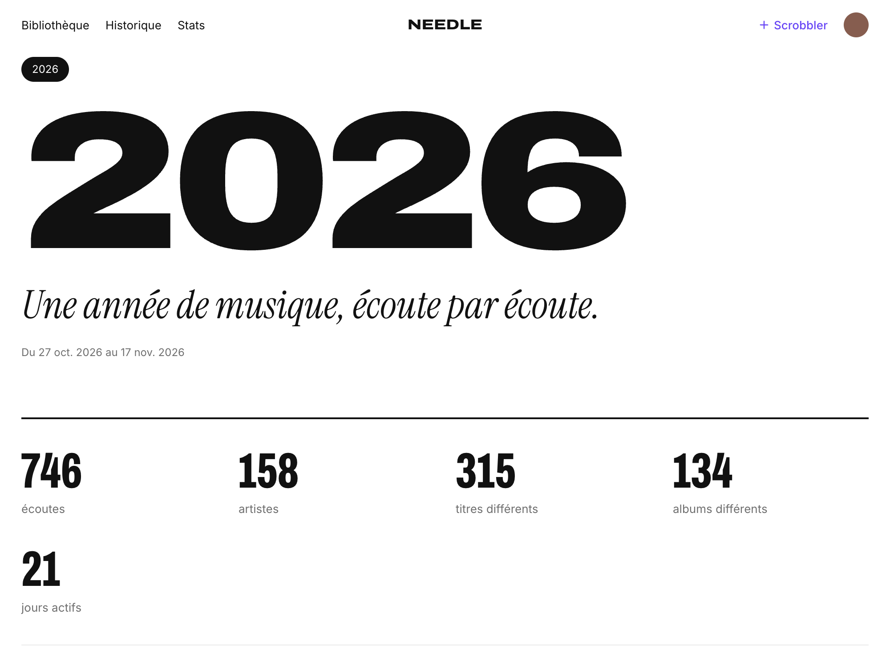

# Apollon: a self-hosted, open source music scrobbler for Cloudflare Workers

**A ListenBrainz-compatible scrobbler you deploy on your own Cloudflare account.** Track every song you play,
browse your listening history, and get detailed listening stats and a yearly "Wrapped"-style review, without
handing your data to a third party. A free, open source alternative to Last.fm and a self-hostable
ListenBrainz server, built on Cloudflare Workers, Turso and KV with Hono and Better Auth.



## Why

- **Your data, your account.** Listens live in your own Turso (libSQL) database. Export, query or delete them whenever you like.
- **Works with the apps you already use.** The server speaks the ListenBrainz API, so any scrobbler that can point at a custom ListenBrainz server can send listens to it.
- **Cheap to run.** Two Workers, one Turso database and one KV namespace. A personal instance fits comfortably in the free tiers of Cloudflare and Turso.
- **Open source.** AGPL-3.0, no tracking, no ads.

## Features

- **ListenBrainz-compatible API** at `/1`: submit listens, now playing, token validation, listen history, listen count, delete a listen, latest import and top artists / recordings / releases.
- **Native JSON API** at `/v1` with an OpenAPI 3 document (`/v1/openapi.json`) and interactive docs (`/v1/docs`).
- **Listening statistics** for any period (this week, this month, this year, last quarter, all time…): top artists, albums and tracks, daily activity, listening clock, streaks, discoveries, forgotten favourites, on repeat, trends, period comparison, one-shots, weekly charts, diversity, listening sessions, repeats, milestones and "on this day".
- **Year in review**, a Spotify Wrapped-style recap of your year: artist of the year, top albums, totals and more.
- **Artist, album and track pages** with first and last listen, play counts and a timeline.
- **Album art** from the Cover Art Archive (by MusicBrainz release ID) with a Deezer fallback by name, cached at the edge.
- **Last.fm import**: upload a Last.fm CSV export from the settings to bring your scrobble history over.
- **Accounts and API tokens** with Better Auth (username + password, per-app API keys that you can revoke).
- **Private profiles**: hide your listens and stats from everyone but yourself.
- **Rate limiting** on the API and auth endpoints, and an optional switch to close sign-ups on a personal instance.

## Screenshots

The web front is called **Apollon**. Its interface is currently in French.

| Listening stats                                                                                                                     | Top artists                                                                        |
| ----------------------------------------------------------------------------------------------------------------------------------- | ---------------------------------------------------------------------------------- |
|  |  |

| Year in review                                                                                                 | Artist page                                                                                       |
| -------------------------------------------------------------------------------------------------------------- | ------------------------------------------------------------------------------------------------- |
|  |  |

## Compatible scrobbling apps

Because the server implements the ListenBrainz API, you connect apps the same way you would connect them to
ListenBrainz: pick **ListenBrainz** (or "custom ListenBrainz server") in the app, then paste your server URL
and an API token. Create the token in the web app under **Réglages → Tokens d'API**; the page shows the server
URL to use next to it.

Apps that let you set a custom ListenBrainz URL include:

| App                                                             | Platform                                                                |
| --------------------------------------------------------------- | ----------------------------------------------------------------------- |
| [Pano Scrobbler](https://github.com/kawaiiDango/pano-scrobbler) | Android, Windows, Linux                                                 |
| [Web Scrobbler](https://web-scrobbler.com/)                     | Browser extension (YouTube, Spotify Web, Bandcamp, SoundCloud…)         |
| [Navidrome](https://www.navidrome.org/)                         | Self-hosted music server                                                |
| [Jellyfin](https://jellyfin.org/) (ListenBrainz plugin)         | Self-hosted media server                                                |
| [Multi-Scrobbler](https://github.com/FoxxMD/multi-scrobbler)    | Self-hosted bridge for Spotify, Plex, Jellyfin, Subsonic, MPD, Last.fm… |

Anything else that talks to the ListenBrainz API with a configurable root URL should work too. Some apps
want the root URL (`https://scrobbler.example.com`), others want the API path (`https://scrobbler.example.com/1/`).

## Quick start: deploy on Cloudflare

You need a Cloudflare account, a [Turso](https://turso.tech/) account with the `turso` CLI, Node.js 22.18+ and [Vite+](https://viteplus.dev/) (`vp`), which installs the
pinned pnpm for you.

```bash
git clone https://github.com/powpowchuuuu/stunning-winner.git scrobbler
cd scrobbler
vp install
```

**1. Create the database and the cache.**

```bash
cd apps/api
turso db create scrobbler
npx wrangler kv namespace create CACHE
```

**2. Store their credentials locally.** Copy `apps/api/.env.turso.example` to `apps/api/.env.turso` and fill in
`TURSO_DATABASE_URL` (`turso db show scrobbler --url`) and `TURSO_AUTH_TOKEN` (`turso db tokens create scrobbler`).
Copy `apps/api/.env.cloudflare.example` to `apps/api/.env.cloudflare` and fill in `KV_CACHE_ID`. Both files are
git-ignored: `wrangler.jsonc` keeps a placeholder ID that the deploy script replaces at deploy time, so your
account's IDs and tokens never end up in the repository.

**3. Set the secrets, run the migrations and deploy the API.**

```bash
openssl rand -base64 32 | npx wrangler secret put BETTER_AUTH_SECRET
turso db show scrobbler --url | npx wrangler secret put TURSO_DATABASE_URL
turso db tokens create scrobbler | npx wrangler secret put TURSO_AUTH_TOKEN
vp run db:migrate
vp run deploy
```

**4. Deploy the web front.** It reaches the API Worker through a service binding, so both share one origin and
Better Auth cookies stay first-party.

```bash
cd ../web
vp run deploy
```

**5. Trust the web origin.** Set `TRUSTED_ORIGINS` in `apps/api/wrangler.jsonc` to the URL of your web Worker
(for example `https://scrobbler.example.com`), then redeploy the API. Open the web app, create your account,
and set `DISABLE_SIGNUP` to `"true"` if the instance is just for you.

Optional API variable: `BASE_URL`, the public URL used by Better Auth (defaults to the request origin).

## Local development

```bash
cp apps/api/.dev.vars.example apps/api/.dev.vars   # set BETTER_AUTH_SECRET
cp apps/web/.dev.vars.example apps/web/.dev.vars
turso dev --db-file .turso/dev.db                  # local libSQL server on http://127.0.0.1:8080 (keep it running)
TURSO_DATABASE_URL=http://127.0.0.1:8080 vp run @scrobbler/api#db:migrate
cd apps/api && vp run dev                          # API on http://localhost:8787
cd apps/web && vp run dev                          # web front on http://localhost:3000
```

Signing in from the local web front also needs `TRUSTED_ORIGINS=http://localhost:3000` in `apps/api/.dev.vars`.

```bash
vp check --fix    # format, lint, type-check
vp run -r test    # all tests
```

## API overview

| Path               | What it is                                                               |
| ------------------ | ------------------------------------------------------------------------ |
| `/1/*`             | ListenBrainz API v1. Authenticate with `Authorization: Token <api key>`. |
| `/v1/*`            | Native JSON API: listens, now playing, profile, stats and insights.      |
| `/v1/openapi.json` | OpenAPI document for `/v1`.                                              |
| `/v1/docs`         | Interactive API reference.                                               |
| `/api/auth/*`      | Better Auth (sign-up, sign-in, sessions, API keys).                      |

Submit a listen exactly as you would to ListenBrainz:

```bash
curl -X POST https://scrobbler.example.com/1/submit-listens \
  -H "Authorization: Token $TOKEN" \
  -H "Content-Type: application/json" \
  -d '{
    "listen_type": "single",
    "payload": [{
      "listened_at": 1763650000,
      "track_metadata": { "artist_name": "Nicki Minaj", "track_name": "Super Bass" }
    }]
  }'
```

Read stats from the native API:

```bash
curl https://scrobbler.example.com/v1/users/<username>/stats/summary
curl "https://scrobbler.example.com/v1/users/<username>/stats/artists?range=this_month"
curl https://scrobbler.example.com/v1/users/<username>/stats/wrapped
```

Errors always look like `{ "code": 404, "error": "…" }` and timestamps are Unix seconds (UTC). See `/v1/docs` on
your instance for every endpoint, parameter and response field.

## Architecture

```
apps/
  api/        Hono Worker: /1 (ListenBrainz), /v1 (native API + OpenAPI), /api/auth (Better Auth)
  web/        TanStack Start front (Panda CSS, Zag.js) on its own Worker, relays API paths via a service binding
packages/
  types/      Wire and domain types
  core/       Business rules behind ports: no I/O, no Cloudflare
  db-d1/      SQLite repositories (D1-shaped driver) and SQL migrations
  db-libsql/  Turso / libSQL driver for those repositories (production database)
  cache-kv/   Workers KV cache
  auth/       Better Auth setup (username + API key plugins)
  testing/    Node-only test doubles (D1 on node:sqlite, KV in memory)
```

- **Ports and adapters.** The core knows nothing about Cloudflare. Storage, cache and auth are adapters, so another database (Postgres, SQLite, Turso…) is a new `packages/db-<name>` that passes the same tests.
- **Protocols are thin.** ListenBrainz and the native API only map their wire format onto the same core services, so a Last.fm-compatible endpoint would be one more folder.
- **Built for Turso's billing.** Turso charges per row scanned and written: batch inserts use a single `json_each` statement, every listen read is bounded by an index (a test checks every query plan), counters are maintained instead of counted, and stats of large histories are cached in KV keyed by the listen count, so new listens invalidate them naturally. The same SQL also runs on Cloudflare D1.

More detail for contributors is in [AGENTS.md](AGENTS.md).

## Tech stack

[Cloudflare Workers](https://workers.cloudflare.com/) · [Turso](https://turso.tech/) ·
[Workers KV](https://developers.cloudflare.com/kv/) · [Hono](https://hono.dev/) ·
[Better Auth](https://www.better-auth.com/) · [TanStack Start](https://tanstack.com/start) ·
[Panda CSS](https://panda-css.com/) · [Zag.js](https://zagjs.com/) · [Vite+](https://viteplus.dev/) · TypeScript

## Contributing

Issues and pull requests are welcome. Run `vp check --fix` and `vp run -r test` before opening a PR, and read
[AGENTS.md](AGENTS.md) for the dependency rules the codebase keeps.

## License

[AGPL-3.0](LICENSE). If you run a modified version as a public service, you must share your changes.
